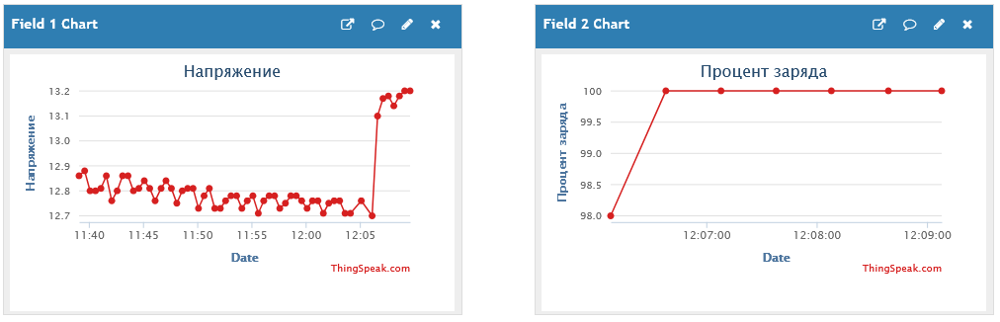

# WiFiBatteryMonitor

Простой способ контроля напряжения аккумулятора и сбора данных в ThingSpeak (платформа анализа данных для интернета вещей, облачный сервис, который собирает показания устройств, хранит их в каналах и позволяет сводить, показывать и анализировать потоки данных в реальном времени).

Данные собираются и передаются в интернет ESP8266 NodeMcu v3.

Из дополнительного обвеса лишь резистор 1,2...1,5 МОм и конденсатор 100...150 нФ (0,1...0,15 мкФ).

== Делитель напряжения, конденсатор 154 и логика подключения ==

На плате ESP8266 NodeMCU v3 вход A0 уже подключён ко встроенному резистивному делителю (220 кОм сверху и 100 кОм снизу до вывода TOUT микросхемы ESP8266, который рассчитан на напряжение не выше 1,0 В). Добавление резистора 1,2...1,5 МОм (1300 кОм): ставится последовательно между плюсом аккумулятора (+12V) и пином A0. Суммарное верхнее плечо составляет 1300 + 220 = 1520 кОм, нижнее — 100 кОм. Коэффициент пересчёта на входе A0 равен 1520 + 100 / 100 = 16,2. При максимальном напряжении 14,8 В на TOUT приходит около 0,914 В — ниже порога 1,0 В.Конденсатор 154 (150 нФ / 0,15 мкФ): подключается параллельно между пином A0 и GND (G). Вместе с сопротивлением делителя он образует RC-фильтр нижних частот, сглаживающий импульсные помехи от роутера и преобразователей питания перед выборкой АЦП. Общий провод (GND): соедините GND аккумулятора, платы NodeMCU v3, модуля LM2596 и нагрузки (роутер). Без общей земли измерение по A0 будет нестабильным.

== Питание по USB 5 В и плата LM2596 ==

При питании NodeMCU v3 от USB 5 В плата получает питание через порт USB и свой бортовой стабилизатор 3,3 В. Модуль LM2596 — понижающий DC-DC преобразователь. Если вы решите питать NodeMCU v3 от аккумулятора 12 В (например, при пропадании USB 5 В), выставьте на выходе LM2596 ровно 5,0 В и подайте на пин VU (Vin) при отключённом кабеле USB, либо используйте LM2596 для отдельной линии питания. Не соединяйте параллельно выходы двух разных источников питания без развязывающих диодов.

== Структурные узлы подключения (по линиям) ==

Измерительная линия АКБ: Клемма +12В АКБ --> Резистор 1,3 МОм --> Пин A0 (NodeMCU v3); между A0 и GND установлен Конденсатор 154 (150 нФ).

Линия земли: Минус АКБ --> GND нагрузки (роутера) --> GND LM2596 --> Пин G / GND (NodeMCU v3).

Линия питания платы: штатно USB 5 В на разъём NodeMCU v3 (либо 5,0 В с выхода LM2596 на VU при автономном питании от 12 В).

Код считывает усреднённое значение с A0, вычисляет напряжение аккумулятора и примерный процент заряда свинцового АКБ, выводит предупреждение в консоль при напряжении ниже 11,5 В и отправляет данные в ThingSpeak (field1 — напряжение в вольтах, field2 — примерный процент заряда).

Перед прошивкой модуля нужно изменить параметры:
const char* WIFI_SSID     = "SSID"; # Имя Вашей беспроводной сети
const char* WIFI_PASSWORD = "PASSWORD"; # Пароль от Вашей беспроводной сети
const String WRITE_API_KEY    = "API_KEY"; # Ключ записи данных Вашего канала (смотреть в Channel Settings), созданного на [ThingSpeak](https://thingspeak.mathworks.com)

# Пример работы системы:

